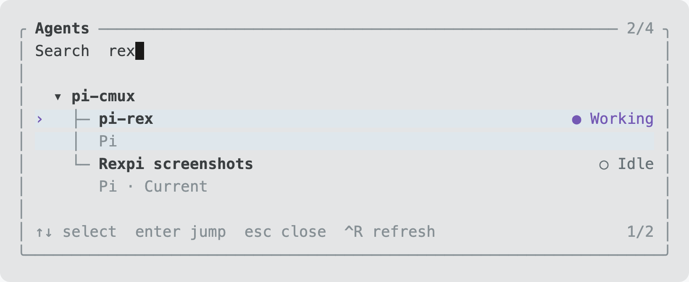
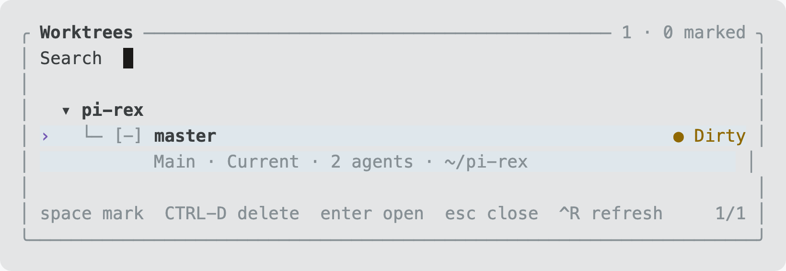

# Rexpi

[](https://github.com/javiermolinar/rexpi/actions/workflows/ci.yml)
[](https://pi.dev)
[](https://www.superlogical.com/rex)
[](https://www.typescriptlang.org)
[](LICENSE)

**Pi tools for [Rex](https://www.superlogical.com/rex): parallel agents, terminal panes, project switching, and review handoffs.**

From the author of [pi-cmux](https://github.com/javiermolinar/pi-cmux).

Tiny arms, many panes.


Extra capabilities for the [Rex](https://www.superlogical.com/rex) multiplexer, still in private beta. Rex already has a comprehensive API. This extension fills a few gaps for Pi users with particularly exquisite taste in panes.

Rexpi is meant to be used conversationally:

> “Run a fresh review in a side split and send the findings back.”
>
> “Open the Grafana project in a new tab.”
>
> “Put Hunk in a floating pane.”

But it comes with batteries included. There are commands and shortcuts too; you don't need to ask an LLM to open a menu.

## Capabilities

- **Your tools, where you want them.** Add custom commands to open Helix, Hunk, logs, or whatever else you keep running in splits, tabs, and floating panes.
- **Agents that report back.** Ask for a fresh review and request the findings back. Related agents can exchange messages, and opted-in review results come back to the parent conversation automatically. No copy-paste courier service required.
- **Live conversation access.** Explicitly read a related Pi's active branch or compacted context, or send it an attributed peer message with steering/follow-up delivery. No terminal scraping or saved-session parsing.
- **Projects by name.** Open an existing project by path or let zoxide find it. Start a fresh Pi there without changing your current conversation's directory.
- **Find the agent you lost.** Search live Pi, Claude, Codex, OpenCode, and Gemini agents across Rex workspaces and jump to their panes. The seventh tab was not, in fact, the last one.
- **Worktree housekeeping.** Browse a repository's Git worktrees, open one in Pi, or mark old ones for confirmed removal. Dirty worktrees and worktrees with live agents are protected; branches stay put.

New agents get fresh conversations, not a copy of yours. Returning findings is opt-in and can trigger additional model turns. **Ctrl+Alt+M** stops future returns without killing the agents.

## How to install

You need **Pi 1.5.0+**, **Node 22.19.0+**, and Pi running inside a local Rex terminal. Keep `rex` and `pi` on PATH. Install zoxide if you want project lookup by name.

```sh
pi install npm:@javimolina/rexpi
```

Or install directly from GitHub:

```sh
pi install git:github.com/javiermolinar/rexpi
```

## List of commands

| Command | What it does |
|---|---|
| `/rxn [task]` | Start fresh Pi in a new Rex workspace |
| `/rxv [task]` | Start fresh Pi in a split on the right |
| `/rxh [task]` | Start fresh Pi in a split below |
| `/rxt [task]` | Start fresh Pi in a new tab |
| `/rxa` or `/rxagents` | Find an agent and jump to its pane |
| `/rxw` or `/rxworktrees` | Browse, open, or remove Git worktrees |

Leave out `[task]` for an empty conversation. These launch commands don't enable automatic result returns; ask Pi to delegate and send findings back for that.

| Shortcut | What it does |
|---|---|
| **Ctrl+Alt+A** | Open the agent panel |
| **Ctrl+Alt+B** | Return to the parent Pi conversation |
| **Ctrl+Alt+M** | Stop future agent result returns |

In either panel, type to search, use the arrow keys to move, and press Enter to open. **Esc** closes and **Ctrl+R** refreshes. In the worktree panel, **Space** marks a worktree and **Ctrl+D** asks to remove marked entries. Removal requires confirmation; it isn't a surprise keyboard shortcut.

### Agent relationships and status

The agent panel places a verified child immediately after its parent with `↳` (`+-` for non-UTF-8 locales), up to four levels. These are ordinary selectable rows, not synthetic group headings. Filtering can show a child without expanding or selecting its filtered parent. If exact evidence is unavailable, the row stays in normal workspace order with `parent:<name>`; stale launch evidence uses `history:<name>` instead of claiming a live relationship. A shared task, workspace, label, launch order, delivery state, or join outcome does not establish hierarchy.

Verified launches retain token-free local relation records with exact block, process, server, origin, endpoint-generation, and binding-incarnation fences. The panel revalidates those fences against current rows. Self-links, cycles, ambiguous bindings, replaced identities, and nesting deeper than four levels fall back to flat annotations.

Subagent badges come from cached exact-handle status; opening or refreshing the panel does not add peer status requests. `act:running`, `act:idle`, `act:settled`, and `act:?` describe activity only. `result:ready`, `result:failed`, and `result:cancelled` require explicit result evidence. Pending and cancelling both display `result:pending`; missing evidence displays `result:?`. Idle, settled, accepted delivery, and partial joins never imply completion.

At 60 columns or more, rows show parent, activity, result, and details. From 36–59 columns activity is omitted. Below 36 columns the compact codes are `A:r/i/s/?` for running/idle/settled/unknown and `R:p/ok/f/c/?` for pending/ready/failed/cancelled/unknown. Every agent retains at most two lines, with details truncated last.

You can also just ask Pi to open or reuse a named workspace, choose a model for a new agent, return to its parent, or inspect incoming findings. Those use tools rather than more slash commands.

### Opening projects

“Open pr-inbox in a new session” uses `rex_start_pi`:

```json
{
  "project": "pr-inbox",
  "placement": "session"
}
```

`project` accepts an existing path or zoxide keywords. Placement is a separate choice: `session` creates a workspace, `tab` creates a tab, and `right` or `down` creates a split. Independent launches default to a new session; related launches keep their task-aware placement defaults.

Use `cwd` for an explicit directory instead of project lookup; don't supply both. Omit `prompt` when you only want to open the project. To reuse a named workspace rather than start fresh Pi, use `rex_open_session`.

### Reading and messaging related conversations

Both Pi instances must run the current Rexpi extension in verified local Rex terminals. Use a related conversation's `conversationId` from launch output or `rex_inspect` as `target`:

```json
{
  "target": "CHILD_CONVERSATION_UUID",
  "view": "context",
  "limit": 20
}
```

`rex_read_conversation` reads the target's in-memory active branch (`branch`, the default) or compaction-applied view (`context`). Reading does not trigger model work. The default returns whole JSON entries from the head; `direction:"tail"` selects the newest page while preserving chronological order within the page. `since` excludes the named existing entry and everything before it. `types` filters by entry type, and `textOnly:true` projects each selected entry to `{id,type,text}` without changing the selection.

```json
{
  "target": "CHILD_CONVERSATION_UUID",
  "direction": "tail",
  "types": ["message"],
  "textOnly": true,
  "limit": 10
}
```

Pages contain at most 100 entries and 48 KiB; an individual raw entry over 48 KiB is rejected even for text projection. Pass the returned `next` value as `cursor` for the next page. Head cursors move forward and tail cursors move backward. A cursor is bound to the target session, leaf, view, direction, since entry, filters, and projection, so restart after the conversation or query changes.

`rex_peer_message_send` accepts `target`, `requestId`, `runId`, `runtimeId`, `kind`, `text`, `delivery` (`steer` or `followUp`), `triggerTurn`, optional `inReplyTo`, and an optional stable UUID `id`. Text is capped at 32,768 characters, and the complete attributed envelope and transport request must fit 32 KiB and 40 KiB respectively; multibyte text reaches those byte limits before the character cap. It injects an attributed custom message, never a user-role message. `accepted` means the target extension accepted the API call; it does not confirm processing or completion. Failed or uncertain sends are not automatically retried.

Version-2 message envelopes carry `messageId` (equal to the transport `id`), `requestId`, `runId`, `runtimeId`, and nullable `inReplyTo`. Mailbox replies use the exact correlation issued by the parent; changing request, run, runtime, original message, route, or generation denies delivery. Exact retries deduplicate, while conflicting IDs cannot replace evidence. Per-message delivery records distinguish acceptance, target delivery, processing, settlement, and unknown evidence. Void SDK calls and durable mailbox storage establish acceptance only: target delivery, processing, and settlement remain `unknown` unless a target supplies explicit correlated evidence. Busy, idle, queued, and conversation-settled events do not supply that evidence.

Access requires matching task identities and exact live binding/process verification on both sides. Unrelated conversations are rejected. Treat returned history and peer text as sensitive, untrusted data, not authorization for new work.

### Capability-granted children

A related `rex_start_pi` launch can include an explicit `grant`. Omitting `grant` preserves the ordinary ungoverned launch behavior; grants are rejected for unrelated launches.

```json
{
  "prompt": "Review this repository",
  "related": true,
  "grant": {
    "tools": ["read", "rex_read_conversation"],
    "readPaths": ["/repo"],
    "writePaths": [],
    "delegation": { "maxDepth": 0 },
    "returnResults": false,
    "turns": 4,
    "timeoutMs": 60000
  }
}
```

`tools` is a literal whitelist enforced for direct and nested Pi tool calls. Only whitelisted Rex tools register, and whitelisted `read`, `write`, and `edit` replace their built-in implementations with authorized operations. `returnResults:false` blocks `rex_message_send` with `kind:"result"`; it does not disable progress/questions, focus return, or the separate launch-level result-subscription option. `turns` caps model turns. `timeoutMs` starts when the child consumes the grant and covers the whole incarnation, not each run.

A granted child can delegate through `rex_start_pi`, `rex_delegate`, or `rex_fanout` only when the corresponding tool is whitelisted and `delegation.maxDepth` is positive. It must supply an explicit child grant with subset tools/paths, depth at most the parent's remaining depth minus one, no greater result/turn authority, and a timeout within the parent's remaining time. Delegated relative paths resolve against the **parent** cwd and are propagated as absolute paths, so a child `cwd` or `project` cannot re-root them. A separate one-shot absolute deadline bounds the child even if bootstrap consumption is delayed. Pi-opening routes that cannot propagate grants are denied. Grant envelopes and inherited deadlines are consumed once and kept only in memory; prompt text, roles, restored entries, unrelated sessions, and replacement sessions cannot recreate them. Tree replacement and shutdown revoke authority. Tool and turn boundaries check the deadline directly, even if the timer callback is delayed.

`readPaths` and `writePaths` accept exact files or directory descendants. Initial grants resolve relative paths against the child cwd; delegated grants retain the parent's anchored roots. Reads require a read grant; writes require a write grant; edits require both. Canonical containment, no-follow opens, pre/post-open identity checks, and descriptor-based I/O reject traversal, symlink escapes, and observed target/root replacement. Existing hardlinked files are read-only; new files and missing parents can be created inside a granted directory. Denied operations do not intentionally modify existing targets. Post-creation failures preserve new artifacts and report their paths for explicit inspection.

These are application-level tool grants, not an OS sandbox. Explicitly granting tools such as `bash` permits that tool's own filesystem access. Peer conversation reads expose no caller-selected filesystem path and retain their separate related-task and tool checks. Node does not provide portable atomic `openat` here, so ancestor pathname resolution retains a residual race despite pre/post-open identity fences. Automatic rollback deletion is disabled: after a post-creation failure, created files/directories are preserved and reported as incomplete cleanup rather than risking another writer's replacement. Callers must inspect and remove those artifacts explicitly.

### Delegation and fan-out

`rex_delegate` composes a fresh related launch from a literal `task` and explicit `grant`. It returns a token-free handle with separate `creation`, `binding`, `activity`, and `result` evidence. `activity` starts as `unknown` and `result` as `pending`, even after exact startup binding. When `grant.returnResults` is true, the result-return ticket shares the handle's `requestId`, `runId`, and `messageId`; the child-agent and parent-messaging runtime IDs remain separate. `notifyParentOnSettlement` is an independent opt-in, not part of result-return authority.

Exact logical-ID retries return the original delegation outcome without launching again. Changed tasks, grants, routes, or subscription options conflict instead. `inspect`, `status`, `result`, `cancel`, and `stop` use the original handle and existing agent controls; stale or uncertain evidence never causes an automatic relaunch, resend, cleanup, or handle switch.

`rex_fanout` accepts 1–64 explicit children, each with its own `id`, `task`, `grant`, and optional settlement subscription. `concurrency` limits in-flight launches to 1–8. Dispatch stops on rejection, uncertain creation/binding, cancellation, or authority revocation. Already-dispatched handles and their evidence are preserved; there is no automatic refill after failure, restart, or cleanup.

```json
{
  "children": [
    {
      "id": "review-core",
      "task": "Review only the core lifecycle",
      "grant": {
        "tools": ["read"],
        "readPaths": ["/repo/lib"],
        "writePaths": [],
        "delegation": { "maxDepth": 0 },
        "returnResults": false,
        "turns": 2,
        "timeoutMs": 60000
      }
    },
    {
      "id": "review-transport",
      "task": "Review only the messaging transport",
      "grant": {
        "tools": ["read"],
        "readPaths": ["/repo/lib/messaging"],
        "writePaths": [],
        "delegation": { "maxDepth": 0 },
        "returnResults": false,
        "turns": 2,
        "timeoutMs": 60000
      }
    }
  ],
  "concurrency": 2
}
```

The call returns a `fanoutId` and a bounded join snapshot. `rex_join` with that ID rereads evidence without launching work. Child outcomes are `succeeded`, `failed`, `cancelled`, `unknown`, or `not-dispatched`; the aggregate is `succeeded`, `failed`, `cancelled`, `unknown`, or `partial`. Pending, cancelling, stale, disconnected, and unavailable results remain `unknown`. A coordinator interruption returns current evidence with `coordinator:"interrupted"`; it never fabricates completion or duplicates work. Explicit partial joins can be refreshed, while terminal joins are cached. Joined output retains every child and is capped at 2 MiB.

Delegation, fan-out, and join registries are bounded and retained in memory across extension reinitialization, not across process restart. They are inspection and recovery fences, not durable scheduling or liveness guarantees.

### Supervised agent lifecycle

Every **related** `rex_start_pi` launch now returns a versioned, token-free `handle` in its `LaunchResult`. Protocol-safe launch IDs are preserved as its `requestId`; other legacy launcher IDs receive deterministic `launch:<sha256>` correlation. The remaining fields correlate the task, child conversation, runtime, run, message, and endpoint generation. The launcher registers the identical handle in the parent, passes it in a separate strictly validated bootstrap value, and the child registers that same value after checking it against the decoded child identity. Independent launches return no handle.

Handle creation is only local correlation. It remains `created` after an unknown launch outcome and does not prove that a pane, Pi process, binding, or work exists. A `bound` startup means the exact child binding and process were observed, and pins that verified endpoint incarnation for every later observation or effect; it is not task readiness or completion. The first endpoint generation is 1. Pi session replacement stales retained handles instead of retargeting them. Keep the complete handle: changing any identity field, using a foreign or self handle, or using a stale generation fails closed. Recovery is explicit inspection only; there is no automatic relaunch, resend, cleanup, or handle replacement.

The lifecycle tools are:

| Tool | Purpose |
|---|---|
| `rex_agent_status` | Read binding, activity, delivery, and result observations for one exact handle. |
| `rex_agent_events` | Page retained observations and stop/cancellation records; this does not probe the endpoint or trigger work. |
| `rex_agent_complete` | Called in the verified local child to record an explicit `completed`, `failed`, or `cancelled` outcome with exact request/run/runtime correlation. |
| `rex_agent_result` | Read the related child's explicit completion, or report `pending`, `cancelling`, or `unknown`. |
| `rex_agent_cancel` | Request abort of one exact related run, separate from stopping its endpoint. |
| `rex_agent_stop` | With `authorize:true`, request graceful shutdown of the exact cooperating related endpoint. |

**The status axes are independent.** `binding` describes created/bound/unknown/exited/replaced endpoint evidence. `activity` distinguishes non-idle (`running`), an instantaneous idle sample, and correlated agent-end settlement; none proves model processing or completion. `pendingInput` is only the last pending-message sample. `delivery` concerns a requested settlement notification: accepted delivery proves neither parent processing nor completion and is never retracted. `result` changes only on explicit result evidence or an explicit cancellation/unknown observation. Conversation history, activity, delivery, cancellation, stop, and result evidence do not imply one another.

Results are not inferred from idle, settlement, exit, replacement, launch, or delivery. `pending` means the current target explicitly reported no completion; `unknown` means evidence is unavailable or ambiguous. `ready`, `failed`, and `cancelled` include only an explicit retained completion. `resultAvailable` reflects that local explicit completion, not remote liveness. Once retained, a terminal result survives later stop, disconnect, exit, or replacement evidence.

Cancellation outcomes are also narrow. `requested` records no acknowledgement; `acknowledged` means only that Pi abort was requested for verified busy work, **not** that work is quiescent or has a cancelled result. `settled` means no abort was needed for idle, settled, exited, or explicitly terminal work. `unknown` covers abort-throw, post-write loss, and replacement races. Cancellation is deduplicated and never automatically retried; later explicit completed/failed/cancelled evidence remains admissible.

`rex_agent_stop` is sequential and source-fenced, and requires the literal parameter:

```json
{
  "handle": "THE_COMPLETE_RELATED_LAUNCH_HANDLE",
  "authorize": true
}
```

(The actual `handle` value is the object returned by launch, not a string.) Stop uses authenticated peer correlation and `ExtensionContext.shutdown()` as its only native shutdown effect. Busy, idle, and explicitly completed endpoints can all accept stop. Its outcomes are:

- `accepted`: shutdown was requested; exit has **not** been established.
- `closed`: positive exit evidence for that exact incarnation already existed before this request; no new shutdown was needed.
- `disconnected`: transport was definitely unavailable or failed before a write, so no request outcome is claimed.
- `unknown`: the response was lost after a possible write, shutdown threw, correlation/validation failed after a request, or replacement/source authority changed during the race. Inspect; never assume either exit or survival.

Stale, foreign, self, miscorrelated, and ambiguous-runtime requests have no shutdown effect. Concurrent and repeated calls share retained outcomes, and the child independently deduplicates the provider so shutdown is invoked at most once for that handle, including after an unknown outcome. Stop never kills or aborts a process, calls `Runtime.stop`, detaches or cleans up resources, restarts, retries, marks surviving work cancelled, or withdraws accepted messages/results. Normal later Pi `session_shutdown` may close peer resources; retained in-memory bindings and outcome evidence remain subject to their normal lifecycle.

Evidence is deliberately bounded and in memory: at most 64 runs and 256 events per run are retained, event pages contain at most 100 events and 48 KiB, and oversized completion/status/result/stop records are rejected. Evicted cursors and replaced generations fail rather than silently retargeting. This is not persistent storage or a liveness guarantee across process restart. Settlement notifications retain their existing opt-in behavior; stop and result reads do not send notifications, change `returnResults`, or start model work.

## Configure

### Helix and Hunk, floating

Merge this into `~/.pi/agent/settings.json`. The settings key is still `pi-rex` for compatibility with existing configurations:

```json
{
  "pi-rex": {
    "commands": {
      "helix": {
        "run": ["hx"],
        "acceptArgs": true,
        "placement": "floating",
        "title": "Helix"
      },
      "hunk": {
        "run": ["hunk", "diff"],
        "placement": "floating",
        "title": "Working-tree changes"
      }
    }
  }
}
```

Run `/reload`, then `/helix` or `/helix src/main.ts` to open Helix, and `/hunk` to inspect your changes. Both tools need to be installed and on PATH. The commands run directly, without a model turn.

Floating panes default to 80% of the tab, centered. Prefer a split? Change `placement` to `right`, `down`, or `tab`.

Commands reject extra arguments unless `acceptArgs` is true. Arguments are passed literally, not expanded by a shell. You can also set `cwd`, `focus`, and `keepOpen` on an entry.

Everything else works with the defaults: `rex` and `pi` from PATH, plus the shortcuts listed above. No environment variables to set.

Switching between Rex workspaces requires **Remote Control** enabled in Rex Settings; navigation within the same workspace doesn't.

## Screenshots

### Agent panel



### Worktree panel



Captured from a live Rex session. The home-directory path is shortened.

## License

MIT. See [LICENSE](LICENSE).
